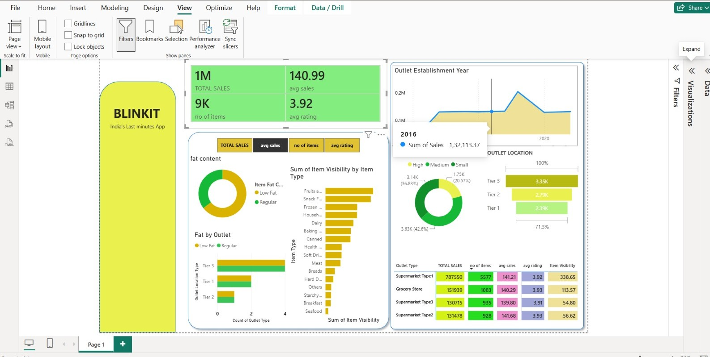

# Blinkit Sales Dashboard | Power BI

## Overview
Blinkit ke sales data ka complete analysis Power BI me kiya.

## Dashboard Preview

## Key Insights
- Total Sales: 1M+
- Total Items: 9K
- Avg Sales: 140.99
- Avg Rating: 3.92
- Supermarket Type 1 ne sabse zyada sales diya
- Tier 3 locations me sabse zyada outlets hai

## Tools Used
- Power BI
- DAX
- Data Cleaning
- Data Visualization

## Author
Govind Singh
